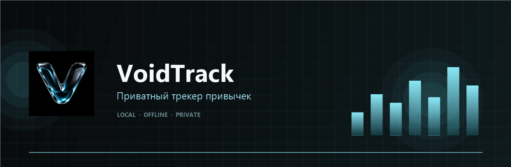

<div align="center">
  
</div>

<p align="center">
  <a href="https://github.com/Dirfiks3/Voidtrack/releases/latest"></a>
  
  
  
  
</p>

<p align="center">
  <a href="#download"><b>Скачать</b></a> &nbsp;·&nbsp;
  <a href="#features"><b>Возможности</b></a> &nbsp;·&nbsp;
  <a href="#reminders"><b>Напоминания</b></a> &nbsp;·&nbsp;
  <a href="#stack"><b>Стек</b></a> &nbsp;·&nbsp;
  <a href="#develop"><b>Разработка</b></a>
</p>

---

## Download

Готовые сборки — в [последнем релизе](https://github.com/Dirfiks3/Voidtrack/releases/latest).
Все бинарники release, без ключей подписи и телеметрии.

| Платформа | Файл | Что это |
|---|---|---|
| **Windows** | [VoidTrack_0.1.0_x64-setup.exe](https://github.com/Dirfiks3/Voidtrack/releases/download/v0.1.0/VoidTrack_0.1.0_x64-setup.exe) | Установщик NSIS — рекомендуемый вариант |
| **Windows** | [VoidTrack_0.1.0_x64_en-US.msi](https://github.com/Dirfiks3/Voidtrack/releases/download/v0.1.0/VoidTrack_0.1.0_x64_en-US.msi) | MSI-установщик |
| **Windows** | [VoidTrack_0.1.0_x64.exe](https://github.com/Dirfiks3/Voidtrack/releases/download/v0.1.0/VoidTrack_0.1.0_x64.exe) | Portable `.exe`, без установки |
| **Android** | [VoidTrack_0.1.0_arm64-release.apk](https://github.com/Dirfiks3/Voidtrack/releases/download/v0.1.0/VoidTrack_0.1.0_arm64-release.apk) | Подписанный APK, ARM64-v8a, Android 7.0+ |
| **Linux** | [VoidTrack_0.1.0_amd64.AppImage](https://github.com/Dirfiks3/Voidtrack/releases/download/v0.1.0/VoidTrack_0.1.0_amd64.AppImage) | Portable AppImage, x86_64 |
| **Исходники** | [VoidTrack-0.1.0-source.zip](https://github.com/Dirfiks3/Voidtrack/releases/download/v0.1.0/VoidTrack-0.1.0-source.zip) | Чистый проект без `node_modules`, `target` и секретов |

SHA-256 всех файлов опубликован в [заметках релиза](https://github.com/Dirfiks3/Voidtrack/releases/tag/v0.1.0).

> На Android приложение работает в полноэкранном режиме: системный статус-бар
> скрыт, верхняя панель с поиском и напоминаниями не перекрывается часами и зарядом.

---

## Возможности

Приватный трекер привычек: данные живут только на твоём устройстве, без аккаунтов
и серверов. AMOLED-чёрный фон, многослойное стекло и интерактивная 3D-серия недель.

| | | |
|:---:|---|---|
| ◉ | **Привычки и отметки** | Создание, редактирование, удаление. Отметки на любую дату и календарь. |
| ◫ | **Статистика** | Серии, процент стабильности, heatmap за 13 недель, цели и шесть достижений. |
| ✎ | **Заметки к отметкам** | Текстовое поле в карточке привычки и история за 30 дней. |
| ⇄ | **Бэкап `.track`** | Свой текстовый формат (`VOIDTRACK 1`, секции `[habits]` / `[checkins]`). Экспорт в файл или буфер, импорт «Объединить» / «Заменить всё». |
| ⌕ | **Фильтры и порядок** | Поиск, фильтр по категории, сортировка по названию/цели/серии, ручной порядок. |
| ✦ | **Подсказки по смыслу** | При вводе названия подбираются описание, категория, иконка и цвет из каталога (148 записей, общий `shared/catalog.json`). |
| ◷ | **Напоминания** | Гибкие расписания по каждой привычке — см. ниже. |
| ◐ | **Внешний вид** | Тема, акценты и 3D-объект недели. На телефоне WebGL по умолчанию выключен для скорости. |

### Надёжность

- На Android исправлен немедленный вылет: корень БД берётся из `app.path().app_data_dir()`.
- Если что-то пойдёт не так — экран с текстом ошибки и стеком, кнопка «Скопировать лог».
  Постоянный журнал: **Настройки → Данные → Журнал ошибок**.
- three.js и каталог вынесены в lazy-чанки; на телефоне WebGL рисуется только по требованию.
- На Android добавлены ProGuard-правила для DTO плагина уведомлений — иначе R8 удалял
  конструктор `DateMatch` и системные расписания отклонялись.

---

## Напоминания

Открой колокольчик в верхней панели или вкладку «Уведомления» в настройках.

- Интервал по умолчанию — **3 ч 30 мин** (диапазон 30–1440 мин, пресеты 2/3/3.5/4 ч).
- Два режима на привычку: **`interval`** (каждые N минут) и **`times`** (фиксированные часы, до 12 слотов).
- Свои дни недели, тихие часы, звук и вибрация.
- Шаблоны заголовка/текста с переменными `{habit}`, `{description}`, `{category}`, `{target}`.
- «Не беспокоить, если сегодня уже выполнено» и кнопка «Проверить уведомление».
- **Windows / Linux:** Rust-планировщик с тиком 15 с — уведомления приходят, пока приложение запущено.
- **Android:** систему планирования использует `tauri-plugin-notification`, уведомления доставляются
  даже после закрытия приложения. Кнопка «Отметил» в уведомлении закрывает привычку на сегодня.
- Разрешение `POST_NOTIFICATIONS` запрашивается при первом запуске, настройки хранятся локально в SQLite.

---

## Стек

- **Tauri v2** + **Rust** — нативное окно, локальная SQLite через `rusqlite` (bundled)
- **React 19** + **TypeScript** + **Vite** — модульная архитектура (`src/features/`)
- **Zustand** — состояние приложения и отдельный стор напоминаний
- **Motion** — анимации; **three.js / react-three-fiber** — интерактивная 3D-серия
- **Tailwind CSS v4** + собственный CSS для liquid-glass эффектов
- **tauri-plugin-notification** — нативные уведомления на всех трёх платформах

---

## Разработка

```bash
pnpm install
pnpm tauri dev      # нативное окно (нужен Rust)
pnpm dev            # только браузер, демо-режим на localStorage
```

Данные хранятся локально:

- в Tauri — `%APPDATA%\com.voidtrack.app\voidtrack.db`
  (старый `trackpriv.db` копируется при первом запуске);
- в браузере — `localStorage` с ключами `voidtrack:*` (демо-режим, старые ключи переносятся автоматически).

**Горячие клавиши:** `N` — новая привычка · `1–4` — переключение разделов · `Esc` — закрыть окно.

### Планы

- Тема «светлый день» и настраиваемые амбиент-эффекты
- Виджеты для рабочего стола и домашнего экрана

---

<div align="center">
  
  <br />
  <sub>Сделано для тех, кто не доверяет свои привычки облаку.</sub>
</div>
